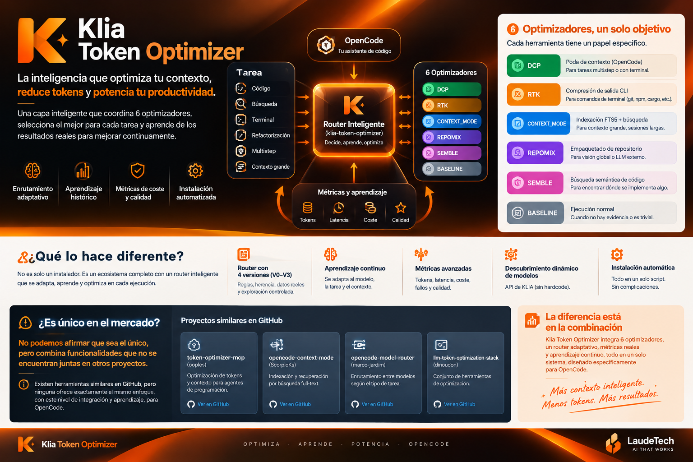
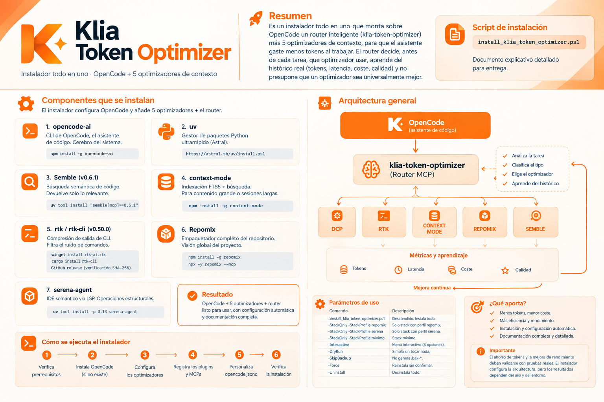

<div align="center">


# Klia Token Optimizer

### Menos contexto innecesario. Decisiones más inteligentes. Métricas para comprobarlo.

[](https://www.typescriptlang.org/)
[](https://nodejs.org/)
[](https://vitest.dev/)
[](https://modelcontextprotocol.io/)
[](./package.json)

**Una capa inteligente para OpenCode que coordina seis estrategias de optimización y utiliza resultados registrados para orientar futuras decisiones.**

</div>

---

## ¿Y si cada tarea utilizara la estrategia adecuada?

No todas las tareas de programación necesitan el mismo contexto ni se benefician de la misma herramienta. Klia Token Optimizer ayuda a elegir entre distintas estrategias en función del tipo de tarea, el modelo y la evidencia disponible en el historial.

El objetivo: **reducir el consumo evitable de tokens sin perder de vista la calidad, los fallos, la latencia y el coste total.**

> Klia no promete un porcentaje de ahorro universal. Permite registrar y comparar resultados para identificar qué estrategias funcionan mejor en cada entorno.

## ¿Qué puede aportar a tu flujo de trabajo?



<table>
<tr>
<td width="50%" valign="top">

### 🎯 Selección según la tarea

El router evalúa el tipo de trabajo y propone una estrategia candidata en lugar de aplicar siempre el mismo optimizador.

</td>
<td width="50%" valign="top">

### 📉 Ahorro medible, no supuesto

Registra tokens y otras métricas para comparar estrategias con el baseline y distinguir ahorro, pérdida o resultado neutro.

</td>
</tr>
<tr>
<td width="50%" valign="top">

### 🧠 Decisiones orientadas por el historial

Las ejecuciones registradas aportan evidencia para adaptar la selección por modelo y tipo de tarea.

</td>
<td width="50%" valign="top">

### ⚖️ Equilibrio entre ahorro y calidad

La evaluación puede considerar tokens, latencia, coste de herramientas, fallos y calidad; no solo el volumen de tokens.

</td>
</tr>
<tr>
<td width="50%" valign="top">

### 🛡️ Fallback conservador

Cuando no hay evidencia suficiente, el router puede recurrir a `BASELINE` en vez de tratar una alternativa no validada como ganadora.

</td>
<td width="50%" valign="top">

### 📊 Visibilidad de los resultados

Consulta estadísticas por modelo y tarea, compara optimizadores y separa datos reales de registros sintéticos.

</td>
</tr>
</table>

## Seis estrategias coordinadas

| Estrategia     | Cuándo puede resultar útil                                             |
| -------------- | ---------------------------------------------------------------------- |
| `BASELINE`     | Referencia de comparación o alternativa segura cuando falta evidencia. |
| `DCP`          | Poda o compresión selectiva del contexto.                              |
| `RTK`          | Reducción del ruido en salidas de terminal, comandos y logs.           |
| `CONTEXT_MODE` | Trabajo con contexto amplio, documentación e indexación.               |
| `REPOMIX`      | Preparación de una vista empaquetada del repositorio.                  |
| `SEMBLE`       | Búsqueda semántica para localizar código relevante.                    |

La selección final depende de las reglas, del modelo, del tipo de tarea y de los datos disponibles; ninguna estrategia se considera ganadora para todos los casos.

## Cómo funciona

```text
OpenCode
   │
   ▼
Clasificación de la tarea
   │
   ▼
Reglas + evidencia histórica + modelo
   │
   ▼
Selección del optimizador
   │
   ▼
Ejecución y registro de resultados
   │
   ▼
Estadísticas para orientar decisiones futuras
```

### Un ciclo de mejora basado en datos

1. **Clasifica** la tarea a partir de señales como la consulta, el número de archivos y el tamaño del contexto.
2. **Evalúa** los optimizadores candidatos y la evidencia que existe para ese modelo y tarea.
3. **Selecciona** una estrategia, con fallback a `BASELINE` cuando corresponde.
4. **Registra** las métricas disponibles de la ejecución.
5. **Compara** resultados para observar dónde hay ahorro, pérdida o ausencia de mejora.

El router contempla cuatro versiones de decisión: desde reglas base (V0), pasando por adaptación con historial (V1–V2), hasta exploración controlada (V3).

## Mide lo que importa

- **Tokens:** consumo total y, cuando está disponible, separación entre entrada y salida.
- **Ahorro relativo:** comparación frente al baseline para la misma combinación de modelo y tarea.
- **Latencia:** tiempo de ejecución.
- **Coste:** coste estimado o registrado y coste de herramientas.
- **Calidad y fiabilidad:** valoración de calidad, fallos y reintentos.
- **Trazabilidad:** modelo, tarea, estrategia, motivo de selección y confianza.

Los resultados dependen de la configuración y de las métricas registradas. Para demostrar un ahorro real, compara las estrategias con el mismo modelo, tarea, repositorio y criterios de calidad.

## Instalación rápida en Windows



El repositorio incluye un instalador PowerShell para preparar el router y los optimizadores contemplados por el proyecto.

```powershell
powershell -ExecutionPolicy Bypass -File install_klia_token_optimizer.ps1
```

El instalador documentado admite perfiles y simulación sin cambios:

```powershell
.\install_klia_token_optimizer.ps1 -StackProfile minimo
.\install_klia_token_optimizer.ps1 -DryRun
```

> Requisitos indicados por el proyecto: Node.js `>= 22.5`, npm y `uv` para las herramientas que lo necesitan. Revisa las instrucciones del instalador antes de ejecutarlo en un entorno de trabajo.

## Ejemplo: consultar una decisión

```bash
npm run router -- --model glm-5.2 --query "refactoriza auth" --files 12 --size 250000
```

La salida incluye el optimizador seleccionado, el tipo de tarea, la versión del router, la confianza y el motivo de la decisión.

Después de ejecutar la tarea, registra métricas reales para alimentar el historial:

```bash
npm run router -- --record-id <RECORD_ID> --tokens 9500 --latency 88 --quality 0.98
```

Consulta las estadísticas:

```bash
npm run router -- stats --model glm-5.2 --real-only
```

Los valores anteriores son un ejemplo de uso, no una promesa de ahorro ni un resultado benchmark universal.

## Integración MCP

El servidor expone cuatro herramientas:

| Herramienta        | Para qué sirve                                    |
| ------------------ | ------------------------------------------------- |
| `route_task`       | Recomendar un optimizador para una tarea.         |
| `record_execution` | Registrar el resultado de una ejecución.          |
| `get_router_stats` | Consultar estadísticas y comparativas.            |
| `migrate_history`  | Migrar el historial al esquema de eventos actual. |

## ¿Por qué Klia Token Optimizer?

Muchos proyectos se centran en una técnica concreta: compactar contexto, filtrar salidas, indexar código o enrutar modelos. Klia adopta un enfoque de coordinación: **reunir varias estrategias en una misma capa y usar los resultados registrados para orientar la selección**.

Su valor debe comprobarse con datos del entorno real. La recomendación es ejecutar pruebas comparables y revisar conjuntamente tokens, calidad, latencia, fallos y coste de la instrumentación.

## Estado del proyecto

- Router adaptativo con versiones V0–V3.
- Seis estrategias contempladas por las reglas del router.
- Registro de ejecuciones e informes por modelo y tarea.
- Servidor MCP y CLI.
- Tests automatizados disponibles en el repositorio.

Para comprobar el estado de una instalación o de una estrategia concreta, ejecuta los tests y realiza un benchmark controlado en tu entorno.

## Desarrollo

```bash
npm install
npm run build
npm test
```

## Documentación

- [Guía de uso de OpenCode](./OPENCODE_USAGE.md)
- [Detalles del instalador](./instaladores/install.md)
- [Convenciones del proyecto](./AGENTS.md)

## Licencia

Licencia ISC. Consulta [`package.json`](./package.json).

---

<div align="center">

**Klia Token Optimizer · Optimiza. Mide. Aprende de los resultados.**

</div>
